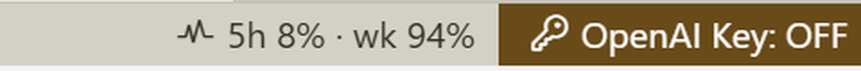

# OpenAI Key Indicator

Status-bar extension for Cursor. It shows whether **Use OpenAI API Key** is on or off.

**Override OpenAI Base URL** can stay pointed at a proxy such as [Ungate](https://github.com/orchidfiles/ungate). Flipping **Use OpenAI API Key** switches the traffic:

- **ON** — custom models go through the saved API key and the override base URL
- **OFF** — built-in models go through Cursor

The extension reads the toggle from Cursor's local state. It does not send the API key anywhere.

## Install

1. Download `openai-key-indicator-0.0.3.vsix` from [Releases](https://github.com/CrocoGen/openai-key-indicator/releases).
2. In Cursor: Extensions, then `...`, then **Install from VSIX**.
3. Reload the window.

The status bar shows `OpenAI Key: ON` or `OpenAI Key: OFF`. OFF uses the warning color.



`Ctrl+Alt+0` (`Cmd+Alt+0` on macOS) toggles the switch and refreshes the label. That runs Cursor's command `aiSettings.usingOpenAIKey.toggle` ("Toggle OpenAI key"). Cursor binds the same command to `Ctrl+Shift+0` by default. The command toggles only when an API key is already saved. An empty key field opens the API key popup.

## Build from source

```
npm install
npm run package
```

Install the generated `.vsix` the same way.

`openaiKeyIndicator.pollIntervalMs` is how often to re-read the toggle, in milliseconds. The default is 30000. The shortcut refreshes within about a second; this interval is only the fallback.
